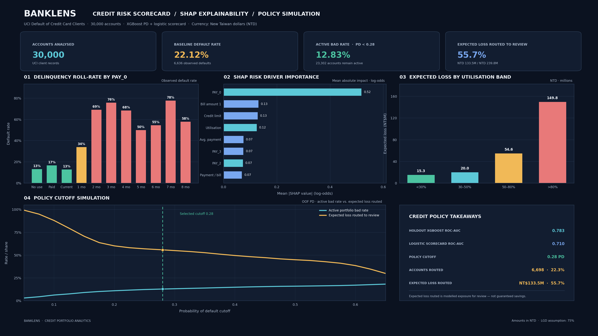

# BankLens — Credit Risk, SHAP Explainability & Expected Loss Policy System

     

## Project overview

BankLens analyses the public UCI Default of Credit Card Clients dataset. The workflow cleans the source fields, engineers credit-utilisation and payment-history features, trains a logistic-regression scorecard and an XGBoost probability-of-default model, explains tree-model contributions with TreeSHAP, and simulates a review/restructure policy using a 0.28 PD cutoff.

All monetary values are in **New Taiwan Dollars (NTD)**, matching the source dataset. EAD is proxied by the latest positive statement balance (`max(BILL_AMT1, 0)`) and LGD is a stated 75% scenario assumption.

## Verified dataset and model results

| Metric | Calculated result |
|---|---:|
| Accounts | 30,000 |
| Observed defaults | 6,636 |
| Baseline default rate | 22.12% |
| Holdout XGBoost ROC-AUC (80/20 stratified split) | 0.7830 |
| Holdout logistic scorecard ROC-AUC | 0.7099 |
| XGBoost 5-fold out-of-fold ROC-AUC | 0.7865 |
| Logistic scorecard 5-fold out-of-fold ROC-AUC | 0.7231 |
| Active-account observed bad rate at 0.28 cutoff | 12.83% |
| Accounts routed to review/restructure | 6,698 (22.33%) |
| Expected loss routed to policy cohort | NT$133.48M (55.66%) |
| Total modeled portfolio Expected Loss | NT$239.79M |

These are actual calculated results from the uploaded UCI file. They are **not** preset targets. The policy result is a retrospective cohort simulation: it measures the observed bad rate among accounts below the cutoff and the modeled EL assigned to accounts above it. It does not establish that all routed expected loss would be saved in practice.

## Feature engineering and model design

- Recode undocumented `EDUCATION` values 0, 5 and 6 to 4 (Others); recode `MARRIAGE` value 0 to 3 (Others).
- Preserve the source repayment field name `PAY_0`; the source does not contain `PAY_1`.
- Engineer `credit_utilization_ratio = max(BILL_AMT1, 0) / LIMIT_BAL`, six-month average bill/payment amounts, payment-to-bill ratio and positive-balance EAD.
- Exclude account ID and the target from model features. Predictors are historical demographic, repayment, statement and payment fields.
- Compare a scaled Logistic Regression baseline scorecard with an XGBoost classifier. Report holdout metrics on a stratified 20% test set.
- Calculate 5-fold out-of-fold PD estimates for each account before portfolio Expected Loss and policy ranking to avoid using in-sample fitted scores for the portfolio view.

## Explainability

TreeSHAP contributions are extracted from XGBoost in log-odds space. The generated `shap_feature_attributions.csv` (included in the project) reports the top drivers measured on the holdout sample. Do not assume an expected ranking: inspect the calculated table. `PAY_0`, `PAY_2` and credit utilisation are among the credit-history features explicitly examined; their exact order and magnitude are data/model-dependent.

## Credit policy simulation

For each account:

`Expected Loss = PD (5-fold OOF) × EAD × 0.75`

Accounts with out-of-fold PD greater than or equal to **0.28** are routed to **REVIEW / RESTRUCTURE**; accounts below the cutoff remain **ACTIVE / MONITOR**. The table `policy_cutoff_curve.csv` shows how the remaining active bad rate and the share of modeled Expected Loss routed to review change across cutoff values.

## Power BI dashboard

Import `banklens_powerbi_ready.csv` into Power BI Desktop and create measures from `PowerBI_DAX_Measures.dax`. The preview is a static image; a `.pbix` file is not included.

## MySQL data model

`BankLens_Credit_Risk_Analysis.sql` creates three tables in MySQL 8.0+:

- `dim_clients` — one row per client, including reference demographics and OOF model/policy fields.
- `fact_bills` — one row per client and statement period (180,000 rows).
- `fact_payments` — one row per client and payment period (180,000 rows).

The SQL includes CTEs, `NTILE(10)`, `LAG()` and `DENSE_RANK()` examples. Load the corresponding CSVs from `data/` after creating the schema.

## Run locally

1. Install dependencies: `pip install -r requirements.txt`.
2. Open `BankLens_Credit_Risk_Analytics.ipynb` from the project root.
3. Run all cells. The notebook reads `data/UCI_Credit_Card.csv` and regenerates the model and outputs.
4. For MySQL, create the `banklens_analytics` database and set `BANKLENS_DB_PASSWORD` in your local environment before running the optional connection cell. Credentials are intentionally not stored in this repository.
5. Import `banklens_powerbi_ready.csv` into Power BI Desktop.

## Project files

- `BankLens_Credit_Risk_Analytics.ipynb` — executed analysis notebook with model, feature-attribution and cutoff outputs.
- `BankLens_Credit_Risk_Analysis.sql` — MySQL 8.0+ schema and analytical queries.
- `banklens_dashboard.png` — 16:9 executive dashboard preview.
- `banklens_powerbi_ready.csv` — flat table for Power BI.
- `PowerBI_DAX_Measures.dax` — reusable measures.
- `data/dim_clients.csv`, `data/fact_bills.csv`, `data/fact_payments.csv` — normalised SQL import data.
- `shap_feature_attributions.csv`, `risk_decile_summary.csv`, `policy_cutoff_curve.csv`, `verified_metrics.json` — reproducibility and review outputs.

## Source

UCI Machine Learning Repository — [Default of Credit Card Clients](https://archive.ics.uci.edu/dataset/350/default+of+credit+card+clients). The source records are a historical Taiwan credit-card dataset; this is an educational analytical project, not a production credit decision system.
